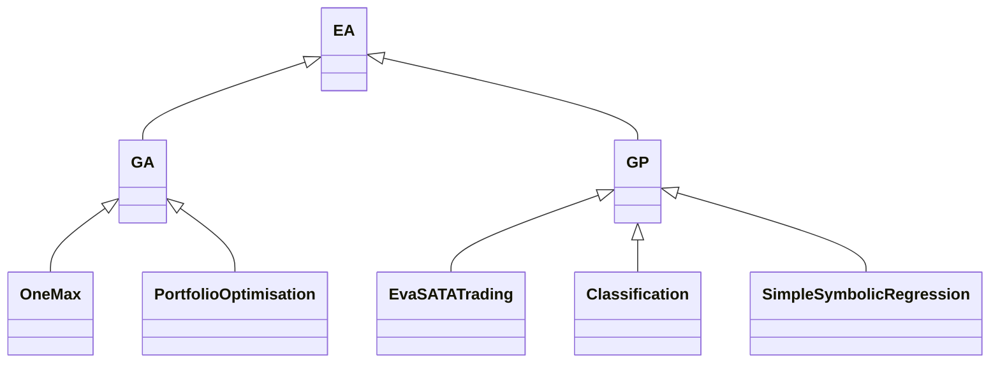

# Evolutionary Algorithms: GA and GP through inheritance

A Python project by Michael Kampouridis implementing **Genetic Algorithms (GA)** and **Genetic Programming (GP)** using object-oriented inheritance. A shared evolutionary algorithm base class provides common behaviour; GA and GP subclasses implement representation-specific operators; concrete problems are implemented as task subclasses under `GA/Tasks/` and `GP/Tasks/`.

## Design and inheritance



The diagram shows representative tasks; further GP tasks are listed below.

- **`EA` (`EA.py`)** is the abstract base class. It defines the common individual representation, tournament selection, the evolutionary loop and experiment orchestration. Abstract methods specify population initialisation, crossover, mutation and evaluation. `Problem` selects maximisation or minimisation.
- **`GA` (`GA/GA.py`) inherits from `EA`** and evolves fixed-length chromosomes with integer or floating-point genes. It supplies random initialisation, one-point crossover and point mutation.
- **`GP` (`GP/GP.py`) inherits from `EA`** and evolves tree expressions represented as prefix lists. It supplies tree generation and genetic operators, with grammar/type information controlling compatible nodes. `GP/Util.py` provides expression and tree utilities.
- **Task classes inherit from `GA` or `GP`** and define the problem-specific fitness function in `evaluate()`. They configure parameters and data and may override inherited operators or the evolutionary loop. For example, `OneMax(GA)` mainly defines fitness as the sum of chromosome genes, while `EvaSATATrading(GP)` supplies trading-specific evaluation and specialised tree behaviour.

This separates reusable algorithm machinery from the individual problem being solved. Inheritance also applies to `Individual`: a task can extend the shared representation with fields such as the number of trades, return or risk.

## Project structure

| Path | Purpose |
| --- | --- |
| `EA.py` | Shared abstract evolutionary algorithm and optimisation direction |
| `GA/GA.py` | Genetic algorithm implementation |
| `GA/Tasks/` | GA problem implementations and example data |
| `GP/GP.py` | Genetic programming implementation |
| `GP/Util.py` | GP expression/tree helpers |
| `GP/Tasks/` | GP problem implementations and example data |
| `GP/test_Util.py` | Existing utility tests |
| `Auxiliary/FileWriter.py` | Experiment settings, logs and result files |
| `requirements.txt` | Dependencies for the included framework and tasks |

This distribution contains the core inheritance framework and task examples. Local virtual environments, IDE settings, generated results, duplicated experiment archives and separate GLA/NSGA research scripts are excluded.

## Included tasks

| Task | Base class | Purpose / input requirements |
| --- | --- | --- |
| `GA/Tasks/OneMax.py` | `GA` | Maximise the number of ones in a binary chromosome; no dataset needed |
| `GA/Tasks/PortfolioOptimisation.py` | `GA` | Portfolio optimisation using `returns.csv` |
| `GP/Tasks/EvaSATATrading.py` | `GP` | Evolve trading rules using sentiment-analysis and technical-analysis features; reads `AAPL_Tr.csv` and `AAPL_V.csv` |
| `GP/Tasks/Classification.py` | `GP` | Classification using the `1301TW5indicators` training/test CSV files |
| `GP/Tasks/SimpleSymbolicRegression.py` | `GP` | Symbolic regression using the same named training/test CSV files |
| `GP/Tasks/Trading.py` | `GP` | Trading task accepting training and test CSV paths as command-line arguments |
| `GP/Tasks/EvaTrading.py` | `GP` | Trading experiment expecting `GAData/AUDUSD/window_1/train.csv` and `val.csv`; these files are not included |
| `GP/Tasks/FCFSymbolicRegression.py` | `GP` | Expanding-window symbolic regression; expects files under `FCF_data/prepared_data_ratios/` |

The ALB CSV files are included directly in `GP/Tasks/`; to use the FCF task, adjust its input paths or place copies in its expected subdirectory. Other task examples may require task-specific configuration; successful execution of one example does not validate every experiment.

## Installation

From the repository root, create an isolated Python environment:

```bash
python3 -m venv .venv
source .venv/bin/activate
python -m pip install -r requirements.txt
```

On Windows PowerShell, use `py -m venv .venv` and `.venv\Scripts\Activate.ps1` instead. The EvaSATATrading example has been run successfully with Python 3.14 on macOS. Dependency versions are not pinned, so this is not an exact historical experiment environment.

## Run the examples

**The repository root must be on `PYTHONPATH`, and the working directory must be the relevant task folder.** Imports such as `from EA import ...` need the root, while CSV paths are resolved relative to the working directory.

On macOS/Linux, from the repository root:

```bash
export PYTHONPATH="$PWD${PYTHONPATH:+:$PYTHONPATH}"
cd GA/Tasks
python OneMax.py
```

For the sentiment/technical-analysis GP trading example, start again from the repository root:

```bash
export PYTHONPATH="$PWD${PYTHONPATH:+:$PYTHONPATH}"
cd GP/Tasks
python EvaSATATrading.py
```

On Windows PowerShell, from the repository root:

```powershell
$env:PYTHONPATH = (Get-Location).Path
Set-Location GP/Tasks
python EvaSATATrading.py
```

The supplied EvaSATATrading settings use one run, a population of 50 and five generations (numbered 0–4). Configuration constants near the top of each task control population size, generations, random seed, crossover probability and other problem-specific settings.

### PyCharm

1. Open the repository root as the project.
2. Select its `.venv` Python interpreter and install `requirements.txt` into that interpreter.
3. Create a Python run configuration with script `GP/Tasks/EvaSATATrading.py`.
4. Set the working directory to `GP/Tasks`.
5. Enable **Add content roots to PYTHONPATH** (or explicitly set `PYTHONPATH` to the repository root).
6. Run the configuration.

For OneMax, use `GA/Tasks/OneMax.py` and working directory `GA/Tasks`.

## Results

Runs create a `Results/` directory inside the working directory. Files include `Setup.txt`, `BestTraining.txt`, `BestTest.txt`, `BestModel.txt` and per-run logs under `Results/Logs/`. Some tasks also write trading signals. A subsequent execution can overwrite previous results: copy results elsewhere before rerunning an experiment you want to retain. Generated outputs are excluded from Git.

## Implement a new problem

1. Add a file under `GA/Tasks/` or `GP/Tasks/`.
2. Subclass `GA` for chromosome-based search or `GP` for tree/program search.
3. Call the parent constructor with the representation and optimisation settings.
4. Implement `evaluate(self, individual, dataset, flag)` and assign `individual.fitness`.
5. Optionally extend `Individual` or override initialisation, crossover, mutation or evolution for the task.
6. Add a `if __name__ == '__main__':` entry point calling `task.run(...)`; use an existing task as a template.

GA supports optional injected individuals. The shared runner calls initialisation without arguments when none are supplied, allowing GP's no-argument initialisation method to work too.

## Scope

These are research/educational implementations and example experiments. Running a trading task successfully demonstrates software execution, not the validity or profitability of a trading strategy. Check data provenance and permissions before redistributing datasets. No software licence is assigned in this preparation; the author should choose one before inviting reuse under specific terms.
